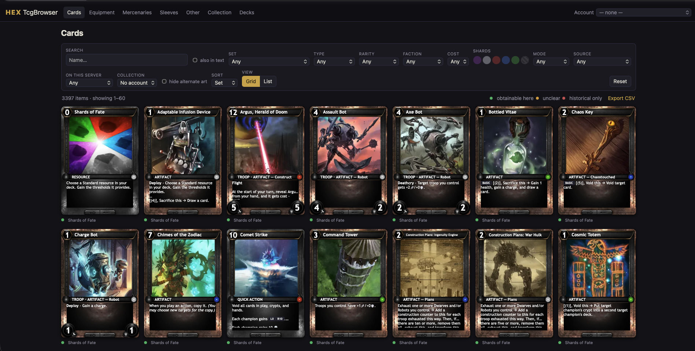
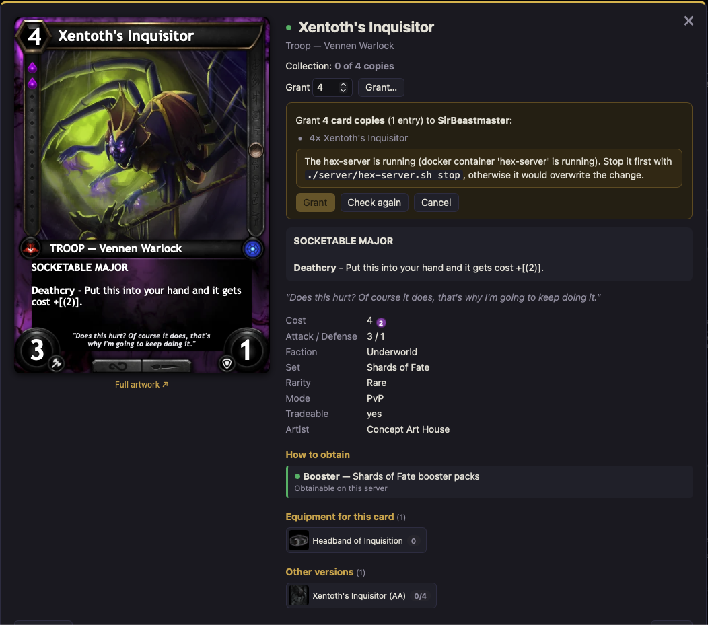
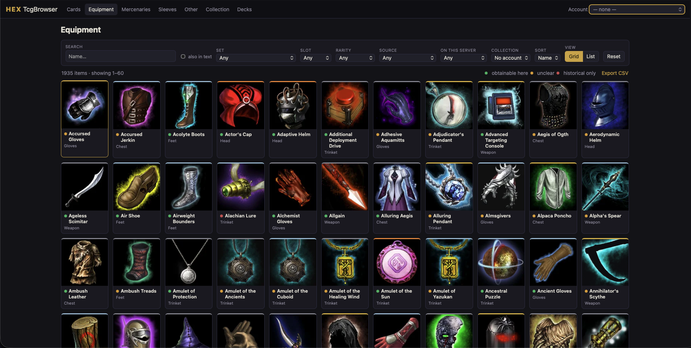
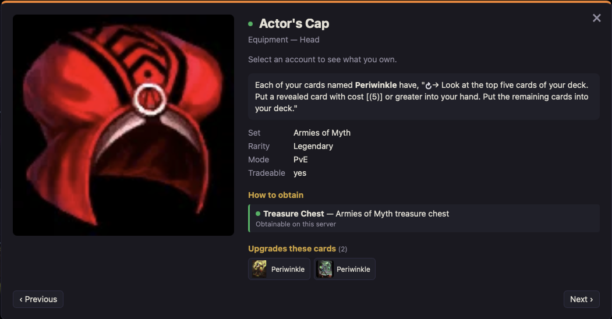
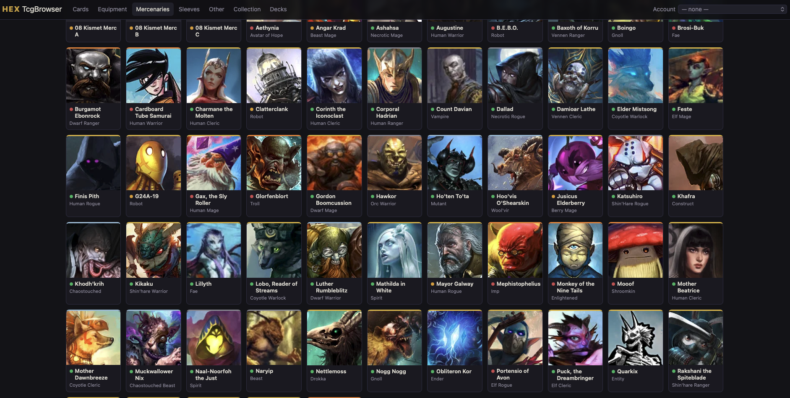
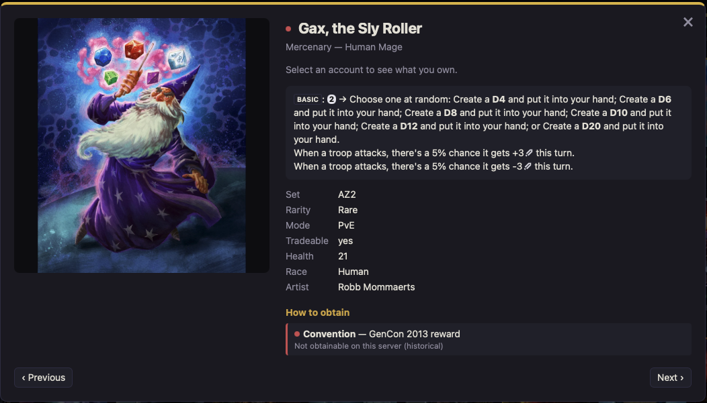
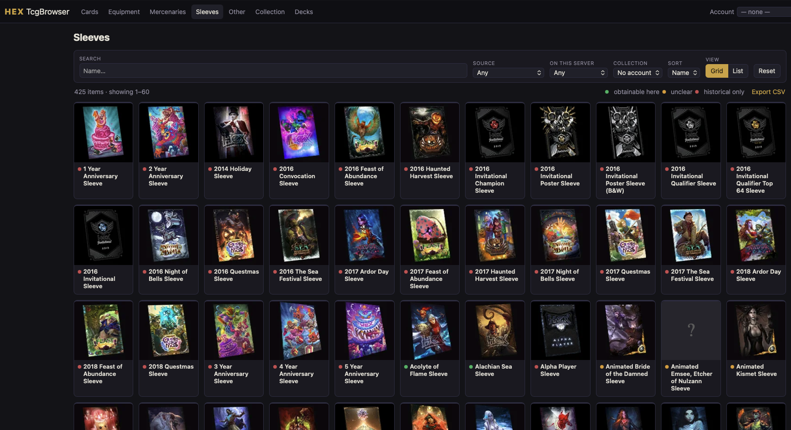
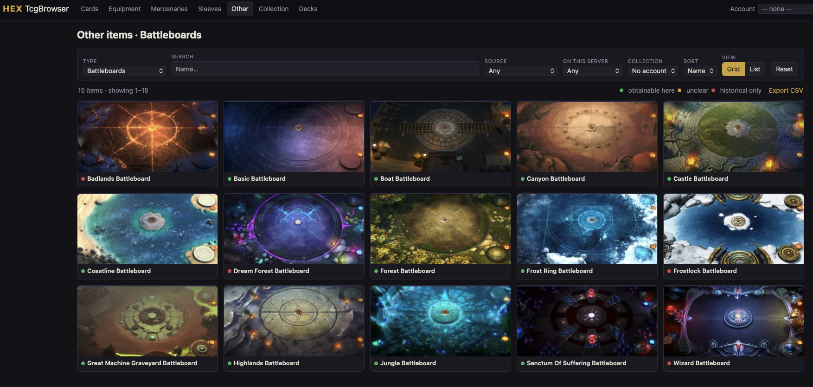

# HEX TCG Browser

A local collection browser for **HEX: Shards of Fate**, made as the companion
to the private server [Criesener/hex-server](https://github.com/Criesener/hex-server).
It also reads the save files of the [HEX Revival](https://github.com/Theveninm/Hex-shard-of-fates-revival)
mod, so it works without a server too (see [Using it with HEX Revival](#using-it-with-hex-revival)).
It brings back what the old *hextcgbrowser* site did: load your account and see
for every card, mercenary, sleeve, piece of equipment and other item:

- **what exists:** the full catalog from the client's gamedata
- **what you own:** read live from the server's `hconnect.db` or from your
  HEX Revival saves
- **how to get it:** booster set, starter deck, store, campaign or PvE reward,
  Frost Ring Arena, Kickstarter tier, and whether it is obtainable on this
  server at all

Operation and filters follow [vs.tcgbrowser.com](https://vs.tcgbrowser.com/#!/cards).
Cards are drawn with the client's original card-frame sprites: threshold gems,
gem sockets, PvE ornaments and ATK/DEF circles.

> Apart from the screenshots below, no game assets are part of this repository.
> Images and data are extracted locally from your own installation of the HEX
> client.



## Features

- **Views:** Cards, Equipment, Mercenaries, Sleeves and Other (gameboards,
  coins, gems, packs, chests, starters), each as a grid or a list.
- **Filters:** search, set, type, rarity, faction, cost, threshold shards,
  ATK/DEF, PvE/PvP, obtain source, and owned / missing / incomplete. The
  filter state is kept in the URL.
- **Detail view:** the card in its in-game look, plus sources with the raw
  game text, alternate arts, starter decks, equipment variants and copies
  owned. Prev/next moves through the list.
- **Collection:** completion per set, kind and source. Missing items are split
  into "obtainable here" and "historical only".
- **Decks:** the account's decks with the cards each one is missing.
- **CSV export:** of any filtered list, or of what is missing.
- **Admin mode** (optional, off by default): grant cards and items to an
  account, on hex-server or in HEX Revival saves.

## Screenshots

**Card detail:** the in-game frame with a gem socket, obtain sources,
equipment, other versions, and a grant dry run in admin mode. Granting is
blocked here because the hex-server is running.



| | |
|---|---|
| **Equipment**  | **Equipment detail**, with the cards it upgrades  |
| **Mercenaries**  | **Mercenary detail**, a historical convention reward  |
| **Sleeves**  | **Battleboards**  |

## How it fits together

```
HEX client install ──► extract_assets ──► cache/art/…     (images, frame sprites)
client Data/gamedata ─► build_catalog ──► cache/catalog.sqlite
hex-server hconnect.db ─────────────────► read-only, live (ownership, decks)
HEX Revival saves ──────────────────────► read-only, live (ownership, decks)
                                             │
                          FastAPI (hexbrowser/server.py) + Vanilla-JS SPA (static/)
                                             │
                                  http://127.0.0.1:8090
```

The browser never needs the server to be running. It opens `hconnect.db` with
`mode=ro` and picks up new cards (an opened pack, say) on the next page load.
The server has no collection API.

## Requirements

- Python 3.11+ (developed on 3.13)
- A local install of the HEX client. Images and the card frame are extracted
  from it.
- The client's `Data/gamedata` file, which is also the data source of hex-server
- Your accounts, from at least one of:
  - a [hex-server](https://github.com/Criesener/hex-server) setup with its
    SQLite database `hconnect.db`
  - a game install with the HEX Revival mod (macOS), see
    [Using it with HEX Revival](#using-it-with-hex-revival)
- Admin mode with hex-server only: before writing it checks that the server is stopped. It asks
  Docker about the `hex-server` container and falls back to probing port 9933.

## Setup with hex-server

The default layout keeps everything next to each other in one parent
directory:

```
Projekte/
  HexTcgBrowser/            this repository
  HexTCG/
    data/raw/gamedata       copy of the client's Data/gamedata
    server-state/hconnect.db
    ref/hex-server/         checkout of Criesener/hex-server (admin mode only)
    server/hex-server.sh    start/stop helper for the Docker container
```

```sh
git clone https://github.com/Criesener/hex-tcg-browser.git HexTcgBrowser
cd HexTcgBrowser
python3 -m venv .venv
.venv/bin/pip install -r requirements.txt
./run.sh
```

The first start extracts the images from the client (several minutes, about
400 MB in `cache/art`) and builds the catalog. Then open
<http://127.0.0.1:8090>.

### Paths

All paths can be overridden with environment variables (`hexbrowser/config.py`):

| Variable | Default | Purpose |
|---|---|---|
| `HEXTCG_ROOT` | `../HexTCG` | base directory for the defaults below |
| `HEX_GAMEDATA` | `$HEXTCG_ROOT/data/raw/gamedata` | the client's gamedata blob |
| `HEX_SERVER_DB` | `$HEXTCG_ROOT/server-state/hconnect.db` | server database (read-only) |
| `HEX_SERVER_SRC` | `$HEXTCG_ROOT/ref/hex-server` | hex-server source, used by admin mode |
| `HEX_CLIENT_ASSETS` | Steam path on `/Volumes/Games/…/Hex.app/Contents/Resources/AssetBundles` | client asset bundles |
| `HEX_CLIENT_DATA` | `$HEX_CLIENT_ASSETS/../Data` | client `resources.assets` (card frame) |
| `HEX_SERVER_CONTAINER` | `hex-server` | Docker container checked by admin mode |
| `HEX_REVIVAL_SAVES` | the Steam install, `/Volumes/Games/HEX-Revival` and `/Volumes/Games/HEX-Test-Mac` (each `…/HexRevivalSaves`) | save folders of the HEX Revival mod, `:`-separated (optional) |
| `HEXBROWSER_CACHE` | `./cache` | extracted images, thumbnails, catalog |
| `HEXBROWSER_PORT` | `8090` | HTTP port |

## Usage

```sh
./run.sh              # serve (extract assets / build the catalog if missing)
./run.sh --rebuild    # rebuild the catalog first (after a gamedata update)
./run.sh --admin      # additionally enable granting items
```

Individual steps:

```sh
.venv/bin/python -m hexbrowser.extract_assets [--force] [group ...]   # cards portraits icons sleeves ui frame
.venv/bin/python -m hexbrowser.build_catalog
```

Choose your account at the top right: by login name or account id. The choice
is remembered in the browser.

## Using it with HEX Revival

If you play with the HEX Revival mod, you need neither hex-server nor the
`HexTCG` directory. Everything comes from your game install.

### 1. Install

```sh
git clone https://github.com/Criesener/hex-tcg-browser.git HexTcgBrowser
cd HexTcgBrowser
python3 -m venv .venv
.venv/bin/pip install -r requirements.txt
```

### 2. Point it at your game

Set the game folder, the one that holds `Hex.app` and `HexRevivalSaves`. With
Steam on macOS that is usually
`~/Library/Application Support/Steam/steamapps/common/HEX SHARDS OF FATE`.
`HEX_GAME` is only a shell helper for the lines below:

```sh
export HEX_GAME="$HOME/Library/Application Support/Steam/steamapps/common/HEX SHARDS OF FATE"
export HEX_GAMEDATA="$HEX_GAME/Hex.app/Contents/Resources/Data/gamedata"
export HEX_CLIENT_ASSETS="$HEX_GAME/Hex.app/Contents/Resources/AssetBundles"
export HEX_REVIVAL_SAVES="$HEX_GAME/HexRevivalSaves"
./run.sh
```

Put the `export` lines into `~/.zshrc` or a small start script, so they are
set every time. Several installs can be read at once: separate them with `:`
in `HEX_REVIVAL_SAVES`. Their accounts then carry the install's folder name.

The first start extracts the images (several minutes, about 400 MB in
`cache/art`) and builds the catalog. Then open <http://127.0.0.1:8090>.

### 3. Choose your account

The account menu at the top right lists your saves under **HEX Revival**:
every offline account in `HexRevivalSaves/<name>/`, and the online account in
`HexRevivalOnline/` if there is one. The menu shows distinct cards and copies.
The in-game collection counts copies, basic shards included.

After playing, **reload the page**. The browser reads the save files on every
request, so it shows what the game last saved. A restart is not needed.

### What is read

- Cards come from `collection.txt`. Equipment, sleeves, mercenaries, packs and
  stardust come from `inventory.txt`, decks from `decks.txt`.
- Accounts created with "everything unlocked" (`unlock=1`) own every
  collectible card as a full playset and every piece of equipment.
- Treasure chests (`chests.txt`) are not items in the catalog and are not
  shown.
- The files are only read. `online_profile.json`, which holds your
  community-server login, is never opened.

### Limits without hex-server

The obtain sources partly come from hex-server's database: which booster set
contains a card, what the store sells, equipment variants. Without it many
cards show "Unknown" as their source, and "Obtainable on this server" means
little. If you have a hex-server `hconnect.db`, set `HEX_SERVER_DB` to it and
run `./run.sh --rebuild`. The database is only read, and its accounts appear
in the menu as well.

### Granting items to yourself

Admin mode can add cards and items to a HEX Revival account:

1. **Quit HEX.** The game keeps your account in memory and would overwrite
   the change on its next save. While it runs from the same install, the
   browser refuses to write.
2. Start the browser with `./run.sh --admin`, with the same `export` lines as
   above.
3. Choose your account. Open an item and click **Grant…**, or filter a list
   (say, missing cards of one set) and click **Grant missing…**.
4. Check the dry run: what would be added, and whether the game is closed.
   Then click **Grant**.
5. Start HEX again.

What it does:

- Cards are added to `collection.txt`. Equipment, sleeves, mercenaries and
  booster packs go into `inventory.txt`. Other items (battleboards, coins,
  gems, starter decks) are not kept in these files and cannot be granted.
- Both files are backed up first, to
  `cache/revival-backups/<install>/<account>/<timestamp>/`. To undo a grant,
  quit the game and copy the two files back into the account's folder.
- Every grant is logged to `cache/admin.log`.
- Accounts with everything unlocked get no grant buttons.
- Only tested on macOS. The check for a running game looks for `Hex.app`, so
  on other systems make sure yourself that the game is closed.

## Admin mode with hex-server

`./run.sh --admin` adds "Grant…" to the detail view and "Grant missing…" to
filtered lists, for example every missing card of a set up to a full playset.
The safeguards:

- Write endpoints exist only in this mode. Without it the API is read-only.
- Every grant is a dry run first and is confirmed in the page.
- Writing is refused while the hex-server is running, because the server would
  overwrite the change. Stop it first with `HexTCG/server/hex-server.sh stop`.
- `hconnect.db` is backed up first, to `hconnect.db.browser-<timestamp>.bak`.
- The grant goes through hex-server's own `profile_db` functions, the same ones
  `new_player.py` uses, in a single transaction. That keeps `collections` and
  `card_instances` consistent. Each grant is logged to `cache/admin.log`.

## API

| Endpoint | |
|---|---|
| `GET /api/meta` | sets, filter values, frame layout, admin flag |
| `GET /api/items` | filtered, sorted, paginated list (`account=` adds ownership) |
| `GET /api/items.csv` | the same filters as CSV |
| `GET /api/items/{guid}` | item detail with sources, alternates, variants |
| `GET /api/accounts` | accounts in `hconnect.db` and HEX Revival saves |
| `GET /api/accounts/{id}/summary` | completion per set / kind / source |
| `GET /api/accounts/{id}/decks` | decks with the cards each is missing |
| `GET /art/{group}/{name}?size=thumb\|full` | extracted images (WebP) |
| `GET /api/admin/status`, `POST /api/admin/grant` | admin mode only |

## Project layout

```
hexbrowser/
  config.py          paths (environment variables)
  gamedata.py        parser for the client's gamedata blob
  build_catalog.py   gamedata + server tables → cache/catalog.sqlite
  sources.py         raw texts and sets → normalized obtain sources
  account.py         read-only access to hconnect.db, dispatches to revival.py
  revival.py         HEX Revival saves: reading, and grants in admin mode
  admin.py           optional grants through hex-server's profile_db
  extract_assets.py  client bundles → cache/art/<group>/*.webp, card-frame atlas
  thumbs.py          on-demand thumbnails
  server.py          FastAPI app
static/              Vanilla-JS SPA (no build step)
run.sh               start script
KONZEPT.md           design notes (German)
```

## Related

- [Criesener/hex-server](https://github.com/Criesener/hex-server): the private
  server this browser reads from, a fork of
  [MTGQuarters/hex-server](https://github.com/MTGQuarters/hex-server)

HEX: Shards of Fate is a trademark of its respective owners. This is an
unofficial fan project for private use with a private server.
